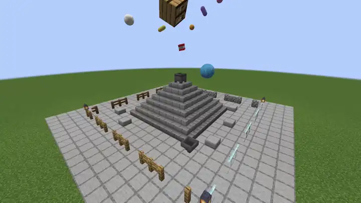
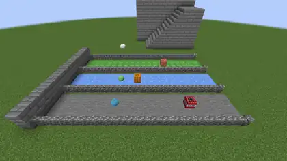
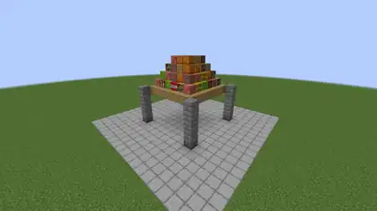
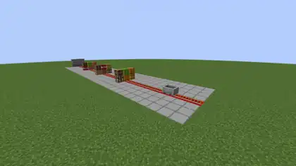
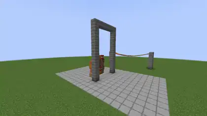
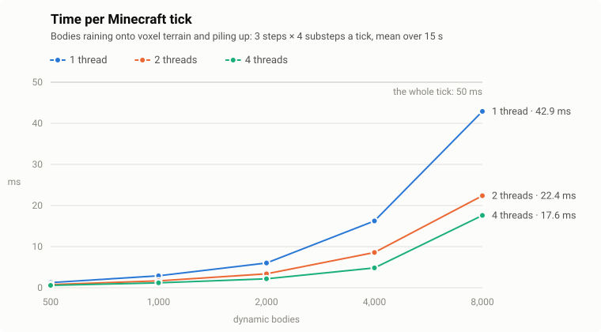
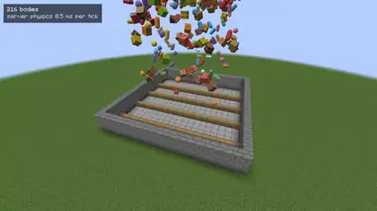

<h1 align="center">MineBox3D</h1>

<p align="center">
  <b>Rigid-body physics for Minecraft.</b><br>
  <a href="https://github.com/erincatto/box3d">Box3D</a> bound to Java, with the world's blocks and entities streamed into the simulation.
</p>

<p align="center">
  <a href="https://github.com/Low-Drag-MC/MineBox3D/actions/workflows/build.yml"></a>
  
  
  
  <a href="https://low-drag-mc.github.io/LowDragMC-Doc/en/minebox3d/"></a>
</p>

<p align="center">
  
</p>

MineBox3D is a library mod for NeoForge. Other mods use it to make bodies that fall, roll, stack, hinge and collide with the world the player sees. It adds no blocks or items of its own, and how a body looks is up to the mod that makes it.

## Features

<table>
  <tr>
    <td width="50%"></td>
    <td width="50%"></td>
  </tr>
  <tr>
    <td><b>Block-exact terrain.</b> Every block's real collision boxes, through a voxel shape added to Box3D: stairs, slabs, fences and walls as Minecraft has them, no seams between blocks, ice that slides and slime that bounces.</td>
    <td><b>A changing world.</b> A block edit reaches the simulation at once, in about a microsecond. Terrain is streamed in only around moving bodies, and a body whose chunk unloads is parked until the chunk returns.</td>
  </tr>
  <tr>
    <td></td>
    <td></td>
  </tr>
  <tr>
    <td><b>Entities take part.</b> Entities near bodies become kinematic bodies that push them; bodies push entities back by mass; entities stand on, ride and step onto bodies.</td>
    <td><b>All of Box3D.</b> Spheres, capsules, boxes, hulls, meshes and height fields; revolute, spherical, prismatic, weld, wheel, distance, motor and configurable constraint joints; ray, shape and overlap queries; contact, sensor and joint events.</td>
  </tr>
</table>

- **Server-authoritative sync.** Mark a body synced and the clients near it receive it, interpolated between ticks, with optional client prediction and rewind.
- **Minecraft coordinates.** Positions are double precision, exact to the world border.
- **Safe from Java.** Arguments are checked before they reach native code, Box3D's failed checks become exceptions, and one world belongs to one thread at a time.
- **One jar, every desktop.** Windows x64, Linux x64 and arm64, macOS on Apple silicon and Intel.

## Performance

<p align="center">
  <picture>
    <source media="(prefers-color-scheme: dark)" srcset="docs/bench/tick-time-dark.svg">
    
  </picture>
</p>

| Workload | Cost |
|---|---|
| 2,000 bodies tumbling onto terrain | **6.0 ms** a tick on one thread, 12% of the tick |
| One block edit | **0.8 µs**, about 750× faster than rebuilding its section as a mesh |
| A closest-hit ray cast | **0.83 µs** |

<p align="center">
  
</p>

Every level tick runs 3 steps of 1/60 s with 4 substeps, on an AMD Ryzen 9 9900X. The full tables, the method and how to run it are in [docs/bench/results.md](docs/bench/results.md) and on the [wiki's performance page](https://low-drag-mc.github.io/LowDragMC-Doc/en/minebox3d/performance.html). Run it yourself with `./gradlew bench`.

## Use it

```groovy
repositories {
    maven { url = 'https://maven.firstdark.dev/snapshots' }
}

dependencies {
    implementation "com.lowdragmc.minebox3d:minebox3d-1.21.1:0.4.0"
}
```

```java
LevelPhysics physics = LevelPhysics.of(serverLevel); // null where the native library cannot load
if (physics != null) {
    Body crate = physics.createBody(new BodyDef().type(BodyType.DYNAMIC).position(x, y, z));
    crate.createShape(new ShapeDef().density(400), Geometry.Box.of(0.4f, 0.4f, 0.4f));
    LevelBodies.setSynced(crate, true); // simulated here, shown on the clients nearby
}
```

The [wiki](https://low-drag-mc.github.io/LowDragMC-Doc/en/minebox3d/) covers getting started, drawing bodies on the client, the physics API, terrain, entities, sync and debugging. In game, `/minebox3d spawn box 20` and `/minebox3d debug` try it out on the client.

## Build from source

You need JDK 21, CMake 3.22 or later, and a C compiler: Visual Studio 2022 on Windows, GCC or Clang elsewhere.

```text
git clone --recurse-submodules https://github.com/Low-Drag-MC/MineBox3D.git
cd MineBox3D
./gradlew build             # native library, jar, format check, JUnit
./gradlew runGameTestServer # GameTests in a real server
./gradlew mb3Setup          # once: the pre-commit format check
```

`native/box3d` is MineBox3D's fork of Box3D (`Low-Drag-MC/box3d`, branch `minebox3d`), which adds the voxel terrain shape. What it changes and why is in [docs/design/02-box3d-fork.md](docs/design/02-box3d-fork.md). CI builds the native library for every platform and publishes the jar from [.github/workflows/build.yml](.github/workflows/build.yml).

## License

MineBox3D is released under the [MIT License](LICENSE).

The native library is built from [Box3D](https://github.com/erincatto/box3d) by Erin Catto, MIT licensed, together with the MIT-licensed code Box3D bundles (rapidhash, Verstable, qsort.h). Their copyright and permission notices are in [THIRD_PARTY_NOTICES.md](THIRD_PARTY_NOTICES.md), and ship inside the jar as `THIRD_PARTY_NOTICES_minebox3d.md`.
